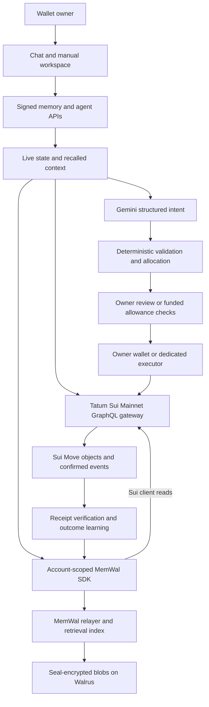

# SolvencyLoop

<picture>
  <source media="(prefers-color-scheme: dark)" srcset="./public/brand/solvencyloop-logo-dark.svg" />
  
</picture>

**A financial assistant that turns verified payments and remembered preferences into better-informed next actions.**

SolvencyLoop brings conversational bill splitting, native-USDC settlement, purchase reflections and optional funded automation into one wallet-owned workspace. Gemini interprets what you want to do. Tatum connects the application to live Sui Mainnet state. Walrus Memory preserves useful context across sessions. Sui Move enforces the financial rules.

**[Open the live application](https://solvencyloop.netlify.app/app)** · **[Explore the landing page](https://solvencyloop.netlify.app/)** · **[Read the technical article on Notion](https://anoopsinghwork.notion.site/SolvencyLoop-Building-a-Financial-Assistant-That-Remembers-What-Actually-Happened-41458f741fb5806bb9d4ff7cdc8ab980)** · **[Verification report](./docs/VERIFICATION_REPORT.md)**

The [repository edition of the technical blog](./docs/SOLVENCYLOOP_TECHNICAL_BLOG.md) contains implementation links and the accompanying evidence. The [brand kit](./public/brand/README.md) includes the current infinity logo, wordmarks, typography and favicon assets.

## Contents

- [Why this application is different](#why-this-application-is-different)
- [Features](#features)
- [Architecture](#architecture)
- [Tatum and Walrus: the intersection](#tatum-and-walrus-the-intersection)
- [How Walrus Memory strengthens the application](#how-walrus-memory-strengthens-the-application)
- [The learning loops](#the-learning-loops)
- [Onboarding and the real application flow](#onboarding-and-the-real-application-flow)
- [Object factory structure](#object-factory-structure)
- [Verification and demonstrated limits](#verification-and-demonstrated-limits)
- [Local setup](#local-setup)
- [Deploy the Move contract](#deploy-the-move-contract-to-sui-mainnet)
- [Environment and memory configuration](#configure-walrus-memory-and-wallets)
- [Validation and production](#validation-and-production)

## Why this application is different

A ledger can show that someone paid. It does not explain why a friend should be excluded from drinks, which purchases a person regretted, or how those facts should influence the next bill. A conversation can discuss those things, but a new conversation needs reliable context and a payment system still needs enforceable rules.

SolvencyLoop connects the full cycle:

**Intent → recall → verify → prepare → authorize → settle → remember → improve the next decision.**

Its novelty is the connection between persistent behavioral context and fresh on-chain evidence:

1. **Preferences can change exact financial inputs.** A saved alcohol exclusion changes item allocations. A saved deposit policy or qualifying repayment history can change a share's upfront-escrow flag. The application computes the amounts before building the transaction.
2. **Payments become reusable evidence.** A confirmed settlement can be remembered with its transaction digest, event identity, amount, timestamp and checkpoint. Future use rechecks its Sui receipt rather than treating recalled prose as proof.
3. **Reflection adds information a chain cannot supply.** Worth It/Regretted feedback connects a purchase to its time and cash-flow context. Qualifying patterns can change the suggested spending room and cooldown amount.
4. **Automation has a durable record and a bounded budget.** Eligible autonomous financial commands require a committed Walrus audit before execution and a separately funded, owner-approved on-chain allowance.
5. **Continuity does not require saving every message.** Recent conversation and an unfinished split can stay in the current tab. Durable writes focus on supported standing preferences, explicit records, verified outcomes and required action audits.

Here, “learning” means recalling useful facts and applying explicit, inspectable rules. It does not mean fine-tuning Gemini, producing a universal credit score or guaranteeing a financial outcome.

## Features

| Capability | What the user can do | What makes it contextual |
| --- | --- | --- |
| Gemini-led workspace | Describe a split, ask about pending bills, prepare a payment or request a cooldown in chat. | Relevant owned memories, actual contacts, loaded bills and verified payment evidence inform the structured response. |
| Reviewed split canvas | Create equal, custom or itemized bills, choose categories and inspect each exact share. | Saved item exclusions and deposit policies shape the allocation; recent created-bill history supplies category suggestions. |
| Contact continuation | Add a missing counterparty and continue an unfinished split with its known amount and people. | The current conversation carries the pending intent; a contact's wallet is never invented. |
| Settlement and upfront escrow | Pay an eligible own share, review bulk settlement, fund a deposit, activate a funded bill, cancel or claim an eligible refund. | The contract checks participant identity, amounts, bill state and funding conditions. |
| Six-hour regret check-ins | Rate a recorded purchase or a bill you created as Worth It or Regretted. | The creator's own bill share and original timestamp are used; feedback is recalled with live balance context. |
| Safe-to-spend suggestions | Inspect wallet balance, reserve, loaded obligations, any suggested shield and the separate agent allocation. | Qualifying regret and cash-flow samples affect the suggestion. Funds are not locked merely because a bar changes. |
| 24-hour cooldown vaults | Review and lock an actual native-USDC amount, then withdraw after maturity. | A suggestion can come from personal context; Move enforces the cooldown and relevant reserve rules. |
| Quiet Memory | Approve a temporary memory session to reduce repeated personal-message prompts. | Each later request remains signed and bound to the exact wallet, linked account, origin and payload. |
| Funded Autopilot, optional | Approve a dedicated executor, USDC budget, payees, action scopes, limits and expiry. | Eligible direct commands and configured incoming-share work use the owner's own allowance; receipts and memory connect the outcome back to future context. |
| Memory and proof inspection | Recall notes and preferences, analyze submitted text, restore indexes, inspect provenance, and correct or stop using supported learned choices. | Memory is available for review rather than hidden behind an unexplained score. |
| Public social preferences and groups | Publish selected social preferences or establish group conventions with member approval. | Only appropriate public facts are shared; private purchase reflections are not pooled into public bill benchmarks. |
| Manual workspace | Use the split, settlement, regret, savings, account and memory screens directly. | Chat is the primary interaction, while the manual workflows remain available. |

Financial flows use **native Circle USDC on Sui Mainnet**. SUI pays gas. A wallet-owned MemWal account is mandatory; an empty account is a valid starting point. There is no seeded-memory requirement or application demo account.

## Architecture

The frontend is **Next.js 15 App Router, React 19 and TypeScript**. The server integrates the pinned MemWal SDK and the official Google SDK with **`gemini-3.5-flash-lite`**. Financial objects live in Sui Move. There is no application database or durable local user-state store; the MemWal relayer still provides its own processing and retrieval index.



The diagram shows the logical flow. Gemini and the MemWal relayer use their own service connections; Tatum supplies the application's Sui transport.

| Layer | Responsibility | Implementation |
| --- | --- | --- |
| Interface | Landing, required onboarding, conversational and manual flows, live loading feedback and proof inspection. | [App workspace](./src/app/app/page.tsx), [components](./src/components), [landing](./src/components/landing/LandingPage.tsx) |
| Intent | A fixed JSON schema, contact resolution, continuation and typed proposals. Gemini never signs transactions. | [Gemini integration](./src/lib/gemini.ts), [agent service](./src/lib/agent-service.ts), [action validation](./src/lib/agent-action.ts) |
| Financial calculations | Micro-USDC allocation, exclusions, repayment summaries and spending-room calculations. | [Money arithmetic](./src/lib/money.ts), [expense engine](./src/lib/expense.ts), [insights](./src/lib/financial-insights.ts) |
| Memory | Scoped recall, selected commits, receipt verification, request authorization and recovery. | [Memory service](./src/lib/memory-service.ts), [evidence checks](./src/lib/memory-evidence.ts), [authentication](./src/lib/memory-auth.ts) |
| Connectivity | Authenticated GraphQL, SDK compatibility, pagination, read coalescing and pacing. | [Transport](./src/lib/tatum-request.ts), [compatibility facade](./src/lib/tatum-compatibility.ts), [browser proxy](./src/app/api/tatum-rpc/route.ts) |
| Financial authority | Profiles, split lifecycle, escrow, reserves, vault maturity, allowance limits and receipts. | [Core Move module](./move/solvency_loop/sources/solvency_loop.move), [Autopilot module](./move/solvency_loop/sources/autopilot.move) |

## Tatum and Walrus: the intersection

**Tatum answers what is true on chain now. Walrus carries forward what is useful to remember.** Together they let the next action use both current financial reality and relevant history.

### Tatum supplies live state and verifiable outcomes

Application Sui traffic uses the authenticated gateway at `https://sui-mainnet.gateway.tatum.io/graphql`. Browser calls go through `/api/tatum-rpc`, keeping the Tatum API key on the server. Despite that proxy's historical name, its wire payload is GraphQL.

| Application-facing operation | Use in SolvencyLoop |
| --- | --- |
| `getObject`, `multiGetObjects`, dynamic-field reads | Discover and validate profiles, genuine MemWal accounts, directories, bills and allowance receipts. |
| Balance, coin and owned-object reads | Display current SUI/USDC balances, select transaction inputs, handle USDC address balances and discover cooldown vaults. |
| Event and checkpoint queries | Load actual bill/settlement history and anchor observations to a checkpoint. |
| Transaction reads and confirmation | Check successful effects and exact payment events before a fact becomes repayment evidence. |
| Move metadata, resolution and simulation | Validate the deployed interface and prepare transactions with the official Sui Core SDK. |
| Signed transaction execution | Submit an already signed transaction through the shared transport. |

These are compatibility-facade operations mapped to GraphQL/Core APIs, not a list of separate REST endpoints. Read requests are paced and identical in-flight reads can be coalesced within a requester. Applicable provider retry delays are honored for reads; signed execution mutations are not automatically retried. Sui page sizes are capped at 50. [Transport implementation](./src/lib/tatum-request.ts), [pagination](./src/lib/tatum-pagination.ts).

### Walrus supplies durable, owner-linked context

The application constructs each MemWal client with the verified user's account, wallet-derived namespace and injected Tatum Sui client. The pinned client-injection patch keeps those SDK Sui reads on the same transport; it does not route all relayer, Gemini or Walrus traffic through Tatum. [Integration](./src/lib/walrus-tatum-memory.ts), [patch](./scripts/patch-memwal.mjs).

The combined loop is concrete: recall a payment observation from Walrus, verify its underlying receipt through Tatum, compute the next bill's exact shares and escrow policy, execute under the appropriate authority, then remember the confirmed outcome. A remembered claim cannot substitute for a valid receipt, and a receipt cannot reveal a person's unrecorded purchase regret.

The coupling also has enforceable boundaries. Registration and financial functions require the genuine linked MemWal protocol account. The autonomous command path requires a committed Walrus audit before invoking the executor. Fresh state and evidence verification use the application's configured Tatum transport. The Move contract does not itself call Gemini or verify every off-chain memory write, and manual capabilities do not all depend on an LLM response.

## How Walrus Memory strengthens the application

### Per-user ownership and recall

Each wallet creates or reuses its own MemWal account. The app delegate and protocol package/registry IDs are shared infrastructure; personal account IDs are discovered on chain and linked to each user's profile. Every memory request checks the profile/account link, owner, active state and authorized delegate.

Walrus Memory stores Seal-encrypted blobs, and committed results expose blob IDs for provenance. Its relayer performs processing and retrieval. SolvencyLoop uses the following SDK operations:

| SDK method | Implemented use |
| --- | --- |
| `rememberAndWait` | Commit explicit notes, preferences, purchases, regret/cash-flow records and verified settlement facts. |
| `rememberBulkAndWait` | Batch supported learned preferences, autonomous audits and receipt-derived records; check per-item commit results. |
| `recall` | Retrieve relevant context before interpretation, bill review and recommendations. |
| `analyzeAndWait` | Analyze user-submitted evidence through the memory SDK. |
| `restore` | Rebuild namespace indexes, surfacing failed or truncated recovery. |

See the official [Walrus SDK reference](https://docs.wal.app/walrus-memory/sdk/api-reference).

### Useful structure instead of a transcript archive

| Namespace or record family | What is retained | How it can matter later |
| --- | --- | --- |
| `social_split_trust` | Explicit payment/alcohol preferences, confirmed settlement facts and required action audits. | Item exclusions, deposit recommendations and auditable financial context. |
| `habit_regret` | Recorded purchases and dated Worth It/Regretted feedback. | Personal reflection and qualifying local-hour regret patterns. |
| `cashflow_elasticity` | Check-in balance/reserve context joined to a purchase. | A larger suggested shield when qualifying regret coincides with lower liquidity. |
| `_learned` namespace | Supported standing bill-category and split-style choices, revisions and stop-using records. | Reuse a stable preference without asking the same question on every bill. |
| Public social commons | Appropriate public preferences, approved group context and reverified on-chain observations. | Shared context without treating another person's private memories as available. |

Personal namespaces are derived as `sl_<canonical-wallet-without-0x>_<category>`. They organize records inside an account; they are not separate permission boundaries.

Commons records also use the caller's authorized account. Shared social context is rehydrated from public Sui data; the application does not gain access to another owner's private namespaces by using the same namespace name.

Ordinary questions and every clarification are not automatically saved. Recent exchanges and a pending split stay in the tab. Under Quiet Memory, supported explicit standing statements may be selected for background storage, validated against the user's actual wording and deduplicated against current preferences. Explicit record requests, confirmed settlement facts and required autonomous audits use their own write paths. Users can inspect and correct supported learned choices. This is selective persistence with defined rules, not a claim that the system automatically learns every personal fact.

### Access and privacy are explicit

Quiet Memory uses a wallet-approved, in-memory browser key for at most one hour. Requests remain payload-signed; the grant does not authorize payments. The on-chain account delegate is a separate permission that the owner can revoke.

Delegate access is account-wide, including memories from other applications in that account. The authorized server and processing services can see plaintext needed for their work; relevant recalled context is sent to Gemini. Encryption is not a promise that the app cannot read authorized data. Profiles, contacts, bills and financial objects are public on Sui. See [Walrus ownership and permissions](https://docs.wal.app/walrus-memory/contract/ownership-and-permissions) and the application's [agent/privacy guide](./AGENT_GUIDE.md).

## The learning loops

### Payment outcomes → next bill

1. A participant settles a share, or an upfront-funded bill is activated, through the real Move flow.
2. The application checks the successful transaction and exact `ShareSettledEvent` data through Tatum.
3. A verified fact can be committed to the authorized owner's MemWal account. A counterparty's private account is not writable merely because somebody else initiated a payment.
4. Later recall retrieves that fact; the application revalidates the receipt, package, native-USDC bill, event identity, amount and settlement timing.
5. Qualifying history informs the next allocation alongside explicit preferences and bill-level choices.

The current adaptive rule considers the latest five qualifying payments above the configured threshold, defaulting to **40 USDC**, and needs at least three observations. Average delay over seven days supports an upfront recommendation; average delay at most 24 hours supports standard settlement. Insufficient or intermediate history does not become an invented trust score. These recommendations affect reviewed inputs or explicitly consented Autopilot actions. [Implementation](./src/lib/financial-insights.ts).

### Purchase reflection → spending-room suggestion

A check-in opens after **six hours** for an owned recorded purchase or the creator's own share of a created bill. It writes the verdict and contextual records; it does not prove a merchant purchase occurred. The separate cooldown vault always retains its **24-hour** contract maturity.

The current suggestion starts with:

```text
Safe to spend = current wallet USDC − reserve − loaded unpaid shares − suggested shield
```

The calculation clamps allocations to available funds. A regret shield needs at least three valid ratings in the last 90 days, a purchase-hour window within one hour of the current local hour, at least two regrets and a regret rate of at least two-thirds. The base shield is the median regretted amount. With enough joined cash-flow observations, a sufficiently lower current balance can increase it by 25%, capped by available funds.

The bar explains the suggestion; it does not move money. A cooldown requires the user's approved transaction or an eligible funded allowance. The rules are inspectable in [financial-insights.ts](./src/lib/financial-insights.ts). Category and intensity are retained as context; the current pattern count does not train a category-specific model or weight ratings by intensity.

## Onboarding and the real application flow

1. Open the [workspace](https://solvencyloop.netlify.app/app) and connect a Sui Mainnet wallet.
2. Create or reuse a genuine owned MemWal account, authorize the app delegate with visible account-wide consent, and register the linked public profile. These on-chain changes need wallet approval and SUI gas.
3. Choose Quiet Memory or individual memory approvals. Optional Autopilot setup is a separate funded policy with its own consent.
4. Wait for account checks, personal memories, social context and payment-evidence verification. A live timeline shows actual stages and counts. Sign-in uses smaller authenticated requests and bounded evidence pages, and the dashboard opens only after the complete result validates.
5. Describe a task in chat or use a manual screen. Gemini returns a constrained JSON intent; application code resolves contacts, validates values and computes exact micro-USDC allocations. Review missing details and the proposed action.
6. Approve the financial transaction in the wallet, or let an already funded and active Autopilot policy handle an eligible direct command within its limits. Only the receipt establishes the outcome.
7. Commit useful outcomes or reflections to memory, then recall and verify them on future interactions.

Autopilot is optional and requires compatible deployed contracts, a configured agent directory and a dedicated executor distinct from the owner. Its policy binds the profile, memory account, executor, payees, scopes, expiry, per-action cap, rolling daily limit and available native-USDC balance. Incoming-share automation also requires that debtor's own current funded consent and configured event delivery. Owner revocation and withdrawals remain available independently of routine work and memory activity. [Autopilot guide](./AUTOPILOT_GUIDE.md).

The `/` landing page is public and does not initialize wallet/chain requests. `/app` requires onboarding. Old `/?split=...` links redirect to `/app?split=...`. Presentation uses the current editorial identity, locally bundled Hanken Grotesk, glass surfaces and motion with reduced-motion/data-saver fallbacks. Animations never authorize or confirm financial work.

## Object factory structure

One published Move package creates independent objects. Users do not deploy an individual contract package to join.

| Object | Responsibility |
| --- | --- |
| Shared `SolvencyRegistry` | Wallet → profile IDs and registered-user count. Only first registration writes it. |
| Wallet-owned `UserProfile` | Public handle, immutable wallet identity, linked MemWal account, reserve, contacts and registration time. Only the `key` ability; no public transfer path. |
| Protocol `MemWalAccount` | A shared MemWal object with a recorded owner and delegates. The app verifies genuine ownership and the profile link. |
| Shared `GroupSplitEscrow<USDC>` | Independent bill state, participants, exact shares, funding and settlement. |
| Owner-held `CooldownVault<USDC>` | A deposit with a contract-enforced unlock time. |
| `AgentDirectory` and `AgentAllowanceVault<USDC>` | Discoverable, individually funded automation policies and on-chain receipts. |

Profile/contact updates and financial functions take the owned profile directly, avoiding global registry writes for those operations. Registration still writes a shared directory, and participants still update shared bill objects. The design does not imply consensus-free payments or measured gas savings.

Every financial entry point checks the genuine linked MemWal account. Recovery operations can permit cancellation, eligible refunds or matured withdrawals after memory access is revoked, while still checking ownership and the actual linked account. Move is the authority for funds, escrow, reserve and cooldown invariants.

## Verification and demonstrated limits

The [verification report](./docs/VERIFICATION_REPORT.md) and [sanitized evidence](./docs/verification/regret-learning-evidence.json) record an owner-authorized Mainnet run on three wallets. It exercised actual application builders, authenticated APIs, Gemini, Tatum, MemWal and Move rather than a replacement mock payment implementation.

| Historical result | Evidence boundary |
| --- | --- |
| 37 successful application transactions | 28 owner-wallet and nine executor transactions; dated receipts are in the report. |
| Seven fully settled bills and 14 debtor shares | Included ordinary settlement, upfront funding/activation and six incoming-agent payments. |
| Three funded allowances and three cooldown deposits | Actual policies and 24-hour vaults were checked; historical allowances may now be expired. |
| Memory writes, recall, SDK analysis and restore | Completed for the three owned accounts; ordinary pending-question text was not saved as memory. |
| Regret feedback used by Gemini | Saved ratings were recalled with blob provenance in a non-writing response. |

**The live regret dataset did not trigger a shield or lower the spending quota.** It did not meet the qualifying sample/window rules. Controlled tests demonstrate the calculation changing when those conditions are met. Similarly, tiny verification payments did not establish adaptive repayment risk above the default 40-USDC threshold. Persistence, retrieval and deterministic rules are verified; improved consumer outcomes, model training and a predictive credit score are not claimed.

The 10 November 2026 UI release also passed 136 TypeScript tests, typecheck, lint, production build and targeted desktop/mobile browser checks. Read-only Netlify checks loaded one owner-authorized wallet's 35 memories with zero rejected settlement proofs. Browser fixtures are isolated to tests and cannot sign or submit transactions. These dated checks are not an independent security audit or a blanket guarantee of hosted availability.

Useful guides: [User flows](./USER_GUIDE.md) · [Agent architecture](./AGENT_GUIDE.md) · [Creator-to-counterparty lifecycle](./LIFECYCLE.md) · [Move deployment](./MOVE_DEPLOYMENT.md) · [Contract checks](./CONTRACT_VERIFICATION.md) · [Netlify deployment](./NETLIFY_DEPLOYMENT.md) · [Production readiness](./PRODUCTION_READINESS.md).

## Local setup

Requirements: Node.js 22+, npm, and the pinned project Sui tools installed by `npm run sui:install`. Build, test and deployment use official **Sui 1.82.3** and its matching framework revision. An isolated **1.72.2** CLI supplies the dependency-only verification interface removed from newer releases. Both Move manifests pin `bf4073918ed33cfa0b09c500658fa116a774bcfd`; lockfiles are checked in. This setup passed live Mainnet dependency source verification and all 47 Move tests on 2026-11-03. See [MOVE_DEPLOYMENT.md](./MOVE_DEPLOYMENT.md).

The Move package also depends on the existing Mainnet MemWal contract. Its official production source is pinned in `move/vendor/memwal` with its license and provenance. Only test-only fixtures are added; this protocol package is not republished with SolvencyLoop. The root manifest uses the current package format with explicit pinned `std`/`sui` dependencies. The vendor's `Published.toml` supplies the existing Mainnet address; legacy `[addresses]` tables are intentionally absent. [CONTRACT_VERIFICATION.md](./CONTRACT_VERIFICATION.md) records the contract/application checks and their limits.

From this folder in PowerShell:

```powershell
npm.cmd ci
if (!(Test-Path .env.local)) { Copy-Item .env.example .env.local }
npm.cmd run dev
```

Open [http://127.0.0.1:3000](http://127.0.0.1:3000). The setup screen and wallet chooser work before deployment; financial actions remain disabled until the required configuration is present. Restart the server after changing environment variables, especially `NEXT_PUBLIC_*` values.

The active server is Next.js. The original Vite/Express preview server and mock API have been removed.

The lockfile also applies compatible security overrides for PostCSS, nanoid, and source-map-js, including Next.js's nested PostCSS dependency. Keep these overrides when updating dependencies and rerun the production advisory check.

## Deploy the Move contract to Sui Mainnet

Follow [MOVE_DEPLOYMENT.md](./MOVE_DEPLOYMENT.md) for the current, tested CLI flow, including fresh publication. Use [AUTOPILOT_GUIDE.md](./AUTOPILOT_GUIDE.md) when upgrading the existing package and retaining its profiles/bills.

Install the pinned project tools and use project commands so an older global CLI cannot select the wrong VM:

```powershell
npm.cmd run sui:install
npm.cmd run sui -- --version
npm.cmd run move:build
npm.cmd run move:test
npm.cmd run move:verify-bundle
npm.cmd run move:verify-deps
```

Build/test/deployment use official Sui **1.82.3** and framework commit `bf4073918ed33cfa0b09c500658fa116a774bcfd`. Dependency-only verification uses an isolated **1.72.2** verifier because the current CLI removed its old `verify-source --verify-deps --skip-source` interface. Project publish/upgrade commands run this real preflight automatically. The global CLI is preserved. These CLI steps use Sui's direct Mainnet endpoint without a Tatum bridge.

A fresh publication creates a new package/registry and does not migrate existing objects. It also requires one `autopilot::create_agent_directory` call. Keep old deployment records for existing funds, and keep the external MemWal binding unchanged. See the deployment guide for output-to-environment mappings, source verification, gas and activation.

## Configure Walrus memory and wallets

Configure the deployed **Mainnet MemWal protocol package/registry** and an app server Ed25519 delegate using the [official MemWal account documentation](https://docs.wal.app/walrus-memory/contract/delegate-key-management). These package/registry IDs are shared protocol infrastructure, different from SolvencyLoop's package/registry. Every connected wallet discovers its own account through the MemWal registry's owner-to-account table; account IDs are stored in each user's SolvencyLoop profile on Sui, never in a global environment setting.

Fill these values in `.env.local`:

```dotenv
NEXT_PUBLIC_SOLVENCY_PACKAGE_ID=0x...64hex
NEXT_PUBLIC_SOLVENCY_REGISTRY_ID=0x...64hex
MEMWAL_DELEGATE_PRIVATE_KEY=your_app_server_delegate_key
GEMINI_API_KEY=your_google_gemini_api_key
NEXT_PUBLIC_MEMWAL_AGENT_ID=0x...delegate_public_key_hex
NEXT_PUBLIC_MEMWAL_PACKAGE_ID=0xe7c16fbea0560e7057e2bf7422feaa4fb313749fc69c9e9092fac7a33b81d7f5
NEXT_PUBLIC_MEMWAL_REGISTRY_ID=0x8bf82c9e09e36b8d1c38298f68b7cb68e7b8762887e7592add9986d5e9cf199f
MEMWAL_SERVER_URL=https://relayer.memory.walrus.xyz
VERIFY_WALLET_ADDRESS=0x...your_connected_wallet
```

The MemWal package/registry IDs above were read from the [public Mainnet relayer configuration](https://relayer.memory.walrus.xyz/config) on 2026-10-30 and match the [official app configuration](https://github.com/MystenLabs/walrus-memory/blob/bbf6b2268f1985bbafbb9f2aab16436fc30da7da/apps/app/.env.example). They are real protocol IDs. Other `0x...` values remain explanatory placeholders: replace them with your deployment output or real wallet addresses. Wallet/object IDs must be nonzero canonical Sui addresses: `0x` followed by 64 hex digits. `NEXT_PUBLIC_MEMWAL_AGENT_ID` is the app delegate's raw 32-byte public key with a `0x` prefix, not its derived Sui wallet address. The setup API and readiness script check that it matches the private delegate key. Generate a separate app delegate using the official `generateDelegateKey()` helper; keep its private key only in server secrets. Users authorize that public key themselves through their wallets. It is never a user's owner-wallet private key.

Before deployment you can confirm the public protocol IDs without credentials:

```powershell
Invoke-RestMethod https://relayer.memory.walrus.xyz/config | Select-Object network, packageId, registryId
```

Use only the protocol IDs from that response. Application traffic stays on the authenticated Tatum gateway; manual Sui CLI deployment and source verification use direct Sui Mainnet. Do not copy alternative RPC URLs into the application. If the protocol package changes, review the vendored contract, Mainnet dependency binding, SDK compatibility and environment together before deployment.

Environment checklist:

| Variable | What you supply | When |
| --- | --- | --- |
| `TATUM_API_KEY` | Your Tatum key enabled for the Sui Mainnet gateway | Before starting the app |
| `MEMWAL_DELEGATE_PRIVATE_KEY` | App delegate private key generated below | Before starting the app |
| `GEMINI_API_KEY` | Private Google AI Studio key with access/quota for `gemini-3.5-flash-lite` | Before starting the app |
| `NEXT_PUBLIC_MEMWAL_AGENT_ID` | Matching raw public key generated below | Before starting the app |
| `NEXT_PUBLIC_MEMWAL_PACKAGE_ID`, `NEXT_PUBLIC_MEMWAL_REGISTRY_ID` | Verified public protocol IDs shown above | Before starting the app |
| `NEXT_PUBLIC_SOLVENCY_PACKAGE_ID`, `NEXT_PUBLIC_SOLVENCY_REGISTRY_ID` | Values from your successful publish transaction | After deployment |
| `APP_ORIGIN` | Leave blank locally; set the public HTTPS origin on a host | For hosted deployment |
| `VERIFY_WALLET_ADDRESS` | An onboarded wallet; an empty memory account is valid | Before `verify:mainnet` only |
| `OPENAI_API_KEY` | Not needed for the default relayer flow; server-only manual mode credential | Optional |

No user wallet private key, personal MemWal account ID, database URL, or payment-provider key belongs in this setup. The RPC URL is fixed in code; the old `NEXT_PUBLIC_TATUM_SUI_RPC` setting is ignored.

To generate the app delegate once, run this locally and copy the two resulting lines into the ignored `.env.local` (or your host's secret settings). No chain transaction is submitted by this command:

```powershell
node --input-type=module -e "import { generateDelegateKey } from '@mysten-incubation/memwal/account'; const k = await generateDelegateKey(); console.log('MEMWAL_DELEGATE_PRIVATE_KEY=' + k.privateKey); console.log('NEXT_PUBLIC_MEMWAL_AGENT_ID=0x' + Buffer.from(k.publicKey).toString('hex'));"
```

Keep this delegate stable across restarts. Rotating it later requires each user to approve the new public key and revoke the old one in their MemWal account.

Remove the obsolete `NEXT_PUBLIC_MEMWAL_ACCOUNT_ID` from existing environment files. It is no longer read. No per-user credentials or account IDs need to be added to `.env.local`. The same backend delegate can be approved by multiple account owners, but the backend still has account-wide access while approved. User-owned accounts provide ownership and revocation control; they do not make the backend unable to read authorized memories. Namespaces organize data inside an account and are not separate access boundaries. See [MemWal ownership and permissions](https://docs.wal.app/walrus-memory/contract/ownership-and-permissions).

Contacts are entered by each user in Account and saved on chain. Select actual contacts when preparing a bill; the agent can request a missing contact's real wallet while preserving the pending split. Wallets must be distinct from each other and the creator. The previous named-contact environment defaults are no longer read. Mainnet USDC is fixed to:

```text
0xdba34672e30cb065b1f93e3ab55318768fd6fef66c15942c9f7cb846e2f900e7::usdc::USDC
```

The default memory flow uses the relayer and does not need an OpenAI key in the application. The optional manual factory uses server-only `OPENAI_API_KEY` and the delegate. **Do not configure `NEXT_PUBLIC_MEMWAL_DELEGATE_KEY` or `NEXT_PUBLIC_OPENAI_API_KEY`.** Those names from the original guide would expose private credentials to the browser.

Both MemWal factories inject the Tatum client. Pinned MemWal 0.1.11 does not natively accept a client in relayer mode; the small, version-checked `scripts/patch-memwal.mjs` postinstall patch adds that injection and disables its public-node fallbacks. Do not use `npm ci --ignore-scripts`. SDK upgrades must review/retest this patch.

## Use and verify the application

Follow [USER_GUIDE.md](./USER_GUIDE.md) for real onboarding, personal contacts, expenses, memory and savings. The demo seeding action and named-contact defaults have been removed. No stored memories are required to complete onboarding.

The workspace includes reviewed itemized splits with alcohol exclusions, adaptive deposit suggestions from reverified settlement events, 6-hour purchase check-ins, and a labelled spending-room/shield suggestion using personal regret and live cash-flow context. Guided popup steps precede manual writes and wallet actions. These manual flows use the existing core interface. Optional funded agent automation uses the new extension, deployment settings and explicit consent described in [AUTOPILOT_GUIDE.md](./AUTOPILOT_GUIDE.md).

The application uses the supported GraphQL path on the fixed Tatum Mainnet gateway. Browser requests still use /api/tatum-rpc. See [PRODUCTION_READINESS.md](./PRODUCTION_READINESS.md) for the reproduced 404 cause, request pacing, Retry-After handling and verification evidence.

Run npm.cmd run verify:infrastructure before onboarding to check the live deployment and relayer without signing or writing. After onboarding, set VERIFY_WALLET_ADDRESS and run npm.cmd run verify:mainnet to check ownership and memory access. An empty memory account is valid.

## Validation and production

```powershell
npm.cmd run typecheck
npm.cmd run lint
npm.cmd test
npm.cmd run move:build
npm.cmd run move:test
npm.cmd run move:verify-bundle
npm.cmd run build
npm.cmd start
```

For browser regression checks, leave a local preview running and run `npm.cmd run test:ui` in another terminal. The suite uses the installed Google Chrome in headless mode and covers the landing interactions, mobile widths, legacy bill links, mandatory onboarding, drawer, Vanta cleanup/context loss and reduced motion. Isolated form checks use esbuild and Playwright interception with test-only fixtures, covering keyboard selection, stale-contact clearing, exact shares, disabled controls and account-wide consent. There is no public component-preview route. `PLAYWRIGHT_BASE_URL` optionally selects another local preview URL. It does not connect a wallet, sign or submit transactions.

Use a single running dev/build/start process per checkout; stop the development server before rebuilding production output. Both dev and production servers bind to loopback locally. A hosted deployment should supply private environment variables through its host's secret settings, set APP_ORIGIN to its public HTTPS origin behind a reverse proxy, and rebuild after changing public configuration. The API routes declare maxDuration = 300 in their Next.js configuration; the host still controls the actual invocation limit. Long relayer or event-processing work can exceed it. Use existing receipt recovery and memory-only retries before another financial action, and review the host-specific deployment guide.

Automated validation covers signature tampering/expiry/origin isolation, RPC routing, exact amounts, rule application, memory commit/error handling, and Move scenarios for funding, cancellation/refunds, unauthorized actions, payment validation, and cooldown/floor enforcement. Standard checks do not submit live payments or fund an executor. Separate owner-authorized Mainnet runs are documented in the [verification report](./docs/VERIFICATION_REPORT.md); their historical results do not authorize repeating financial work against other wallets.

For Netlify, see [NETLIFY_DEPLOYMENT.md](./NETLIFY_DEPLOYMENT.md). Sign-in uses sequential authenticated personal-memory, social-context and evidence requests, with at most five personal evidence candidates per page and an overall cap of 20. NDJSON status/keepalive frames support the live timeline; Quiet Memory approval shows activity inside its own card. Streaming does not extend a host's total function limit. The dashboard waits for all parts to validate; there is no successful empty-memory fallback.

The original [LOCAL_VERIFICATION.md](./LOCAL_VERIFICATION.md) is a historical baseline of the unmodified repository, not the status of this implementation.

References: [Next.js 15 App Router](https://nextjs.org/docs/15/app/getting-started/installation), [Tatum Sui gateway](https://tatum.io/chain/sui), [Sui package management](https://docs.sui.io/develop/manage-packages), [MemWal SDK](https://docs.wal.app/walrus-memory/sdk/api-reference).
