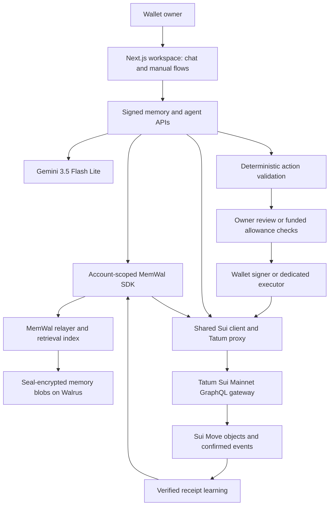
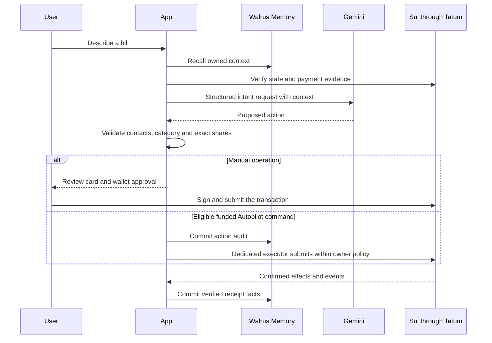

# SolvencyLoop: Building a Financial Assistant That Remembers What Actually Happened

*Implementation and verification review: 10 November 2026. This article describes the current working tree, including the six-hour regret check-in policy. The accompanying [verification report](./VERIFICATION_REPORT.md) separates live results, controlled tests and limitations.*

Splitting a bill is straightforward arithmetic. Remembering why one person should not share the drinks, whether another person normally pays promptly, and whether a purchase still feels worthwhile the next morning is a different problem.

SolvencyLoop connects those decisions. A user can describe a native-USDC bill in chat, review the proposed allocation, settle it on Sui, and later tell the application whether their own share was worth it. The next interaction can use that history instead of starting from an empty conversation.

Three systems have distinct jobs: **Gemini interprets intent, Sui Move controls assets, and Walrus Memory retains context**. Tatum supplies the application's authenticated Sui connectivity. The result is a financial workspace whose suggestions can change with evidence while financial authority remains explicit.

There is an important distinction between that architecture and a proven financial outcome. We verified real payments, persistent memory, accurate retrieval of feedback, and the application's recommendation calculations. We have not shown that randomized demonstration feedback improves a person's spending decisions. In fact, the current live test ratings correctly leave the safe-to-spend quota unchanged. Understanding why is part of understanding the product.

## What the application does

The public route `/` explains the product. The `/app` workspace requires wallet-owned memory onboarding and provides both chat and manual screens.

| Capability | Current behavior |
| --- | --- |
| Wallet and memory onboarding | Discover or create a genuine MemWal account, authorize the app delegate, and link it to an on-chain profile. |
| Contacts and profiles | Store a public handle, real wallet contacts, memory link and USDC reserve in a wallet-owned profile. |
| Bill splitting | Prepare equal, custom or itemized shares; choose a category; review amounts and upfront funding requirements. |
| Settlement | Pay an eligible own share, fund an upfront deposit, activate a funded bill, or settle multiple eligible shares. |
| Payment learning | Save confirmed settlement facts, recall them, and reverify the underlying events before using them as payment evidence. |
| Regret check-ins | After six hours, rate an owned recorded purchase or a bill the user created. A bill contributes the creator's share. |
| Spending-room suggestions | Combine the live wallet balance, reserve, loaded unpaid shares and qualifying regret patterns. |
| Cooldown protection | Lock a chosen USDC amount in an owner-held Move vault with a 24-hour maturity. |
| Quiet Memory | Use a wallet-approved temporary browser key for signed memory requests, reducing repeated message prompts. |
| Funded Autopilot | Permit a dedicated executor to perform eligible actions within the owner's funded on-chain policy. |
| Additional social features | Self-published preferences and group conventions with member approvals. These exist in code but were not all exercised in the reported live run. |

Payments use native Circle USDC; SUI pays network gas. Recording a self-reported purchase is not an on-chain merchant payment. Creating a split proves a bill object exists, not that a restaurant or other merchant issued an invoice.

## Architecture: language, memory and financial authority

The application uses Next.js 15, React 19 and TypeScript. It has no application database for profiles or financial state. That does not mean the entire infrastructure has no indexes: Walrus Memory's relayer provides memory processing and retrieval services.



The normal chat path does not ask Gemini to sign a transaction. It asks Gemini for a structured interpretation. Application code resolves contacts, validates identifiers, computes exact allocations and builds the programmable transaction. The wallet or the dedicated executor supplies the signature, and Move decides whether the action is valid.

The manual interface remains available. Gemini availability is essential to the LLM interaction path, but removing Gemini does not remove every manual capability. Likewise, the contract requires the linked MemWal protocol account; it does not directly inspect a Gemini response or prove that every off-chain memory operation succeeded.

For autonomous commands, the server adds a stronger application-level dependency: it commits a Walrus action audit before invoking execution. If that audit cannot be committed, the command does not proceed through that path. See [memory-service.ts](../src/lib/memory-service.ts) and [agent-executor.ts](../src/lib/agent-executor.ts).

### One package, independent objects

SolvencyLoop uses an object-factory structure rather than deploying a contract for each user.

| Object | Responsibility |
| --- | --- |
| Shared `SolvencyRegistry` | Wallet-to-profile directory and registered-user count; written during first registration. |
| Wallet-owned `UserProfile` | Handle, immutable wallet identity, MemWal account link, reserve and contacts. It has no public transfer path. |
| MemWal protocol `MemWalAccount` | A shared protocol object with an owner field and delegate permissions; the application verifies the connected wallet's ownership and profile link. |
| Shared `GroupSplitEscrow<USDC>` | Per-bill participants, shares, funding and settlement state. |
| Owner-held `CooldownVault<USDC>` | A particular deposit and its contract-enforced unlock time. |
| Shared `AgentDirectory` and `AgentAllowanceVault<USDC>` | Discoverable, independently configured funded agent policies and receipts. |

Profile/contact updates and financial functions take the user's profile directly rather than rewriting the global registry. Participants still contend on a shared bill when updating that bill, and MemWal accounts are shared objects. This design is not a claim of consensus-free payments or a measured throughput improvement.

The implementation is in [the core Move module](../move/solvency_loop/sources/solvency_loop.move) and [the Autopilot module](../move/solvency_loop/sources/autopilot.move).

Bill categories use a versioned title encoding such as `[sl1:dining]` rather than an extra field in the deployed bill layout. The UI decodes that value and derives category suggestions from actual created-bill history. [bill-category.ts](../src/lib/bill-category.ts)

## The Tatum APIs actually used

SolvencyLoop uses Tatum as its runtime Sui gateway. It is not using Tatum's custodial-wallet, virtual-account or fiat-payment products.

The working application transport sends GraphQL to:

```text
https://sui-mainnet.gateway.tatum.io/graphql
```

The browser uses the application's `/api/tatum-rpc` proxy. Server code uses the same authenticated transport directly, with the Tatum key in the server-side `x-api-key` header. The proxy's historical name does not mean the payload is JSON-RPC. [Tatum's gateway guide](https://docs.tatum.io/docs/how-to-connect-rpc-gateway) and [Sui reference](https://docs.tatum.io/reference/rpc-sui) describe the provider; the exact mapping below is established by this repository's adapter and live verification, rather than by assuming a legacy method catalog describes the current wire protocol.

| Application-facing operation | Actual integration | Why it is needed |
| --- | --- | --- |
| `getObject`, `multiGetObjects` | GraphQL Core object reads | Profiles, accounts, bills, vaults and directory identity checks. |
| `getDynamicFieldObject` | Derive the dynamic-field ID, then read its object | Wallet/profile lookup, MemWal ownership directory and agent receipts. |
| `getAllBalances` | Core `listBalances` with pagination | Native-USDC and SUI balance displays and live memory context. |
| `getCoins` | Core `listCoins` | Select actual coin objects for transaction inputs. |
| `core.getBalance` | Core balance query exposing address balance | Redeem a USDC shortfall when tokens are held without coin objects. |
| `getOwnedObjects` | Core `listOwnedObjects` | Discover owned cooldown vaults and other typed owned objects. |
| `getCoinMetadata` | Core coin metadata query | Verify native Circle USDC's symbol and six decimal places. |
| `getLatestCheckpointSequenceNumber` | GraphQL checkpoint query | Anchor reads and memory facts to a real checkpoint. |
| `getChainIdentifier` | GraphQL chain identifier | Reject a network other than Sui Mainnet. |
| `queryEvents` | Core `listEvents`, with opaque cursors | Find bill creation and relevant application events. |
| Normalized Move function/struct reads | Core function introspection and a GraphQL struct-layout query | Validate the deployed interface, including actual MemWal object references. |
| Transaction resolution and simulation | The official SDK Core API over the injected client | Resolve objects, gas and transaction eligibility before signing. |
| `getTransactionBlock`, `waitForTransaction` | Core transaction reads and confirmation | Verify successful effects, events and checkpoint identity. |
| `executeTransactionBlock` | Core execution using GraphQL `executeTransaction` | Submit an already signed transaction. |

These facade names support the app's existing Sui integrations; they are not separate REST endpoints. The mappings live in [tatum-compatibility.ts](../src/lib/tatum-compatibility.ts).

The shared requester coalesces identical in-flight reads and paces requests. It honors applicable read-side retry delays. Signed execution mutations are neither automatically retried nor coalesced. Page sizes are capped at 50, including Core SDK calls used by gas resolution and memory sessions. Event scans begin no earlier than the verified package publication checkpoint. See [tatum-request.ts](../src/lib/tatum-request.ts) and [tatum-pagination.ts](../src/lib/tatum-pagination.ts).

Contract publishing is a separate owner-operated Sui CLI task. Runtime Tatum connectivity does not require deploying the contract through a Tatum bridge.

### A real integration issue: balance is not a coin object

The live run found wallets with 1 USDC displayed but no spendable USDC coin objects. Sui can hold tokens as address balances as well as coin objects; the [official SDK documentation explains the distinction](https://sdk.mystenlabs.com/sui/transactions/coins-and-balances).

The original builder searched only coin objects. The corrected shared builder checks the actual address-balance shortfall and redeems it with `tx.withdrawal()` and `0x2::coin::redeem_funds` in the same sender-signed transaction. It preserves the native-USDC restriction and the contract's actual reserve coin. A newly redeemed exact-payment coin's zero remainder is consumed rather than stranded.

This fix applies to real settlement, allowance funding and cooldown flows. It is not a test-only top-up or an alternate payment mode. The code is in [onchain-user-manager.ts](../src/lib/onchain-user-manager.ts).

## How Walrus Memory is integrated

Walrus Memory's SDK represents a completed memory with a blob ID and supports recall, analysis and restore. Its documentation describes Seal-encrypted blobs and asynchronous processing. SolvencyLoop waits for commit results where durable evidence is required, rather than counting a submitted job as a saved memory. [Walrus SDK reference](https://docs.wal.app/walrus-memory/sdk/api-reference)

Each wallet has its own MemWal account. The package/registry identifiers and the app's server delegate are shared configuration; the user's account ID is discovered and verified against the on-chain profile. A namespace is useful organization, but it is not a replacement for checking the actual account owner and permissions.

The main namespaces are derived from the canonical wallet:

```text
sl_<wallet>_social_split_trust
sl_<wallet>_habit_regret
sl_<wallet>_cashflow_elasticity
```

There is also an observations namespace for learned preferences, plus a separately named commons namespace for appropriate public on-chain social facts. Those do not authorize access to another user's private memory.

| SDK operation | Application use |
| --- | --- |
| `rememberAndWait` | Explicit preferences, notes, purchases, regret feedback and verified settlement facts. |
| `rememberBulkAndWait` | Batches of learned preferences, autonomous action audits and receipt-derived facts. |
| `recall` | Retrieve context before interpretation or recommendations. Important payment claims are reverified against Sui. |
| `analyzeAndWait` | Analyze submitted evidence through the SDK; it is not a call that fine-tunes Gemini. |
| `restore` | Recover/reindex a namespace; failed or truncated recovery is not reported as complete. |

The normal factory uses `MemWal.create` with the verified account ID, wallet namespace and injected Tatum Sui client. A pinned installation patch preserves that client injection, and the application checks it at runtime. This keeps SDK Sui reads on the same transport. Gemini requests, relayer calls and Walrus/Seal services remain their own network interactions; Tatum is not a proxy for all of them. [walrus-tatum-memory.ts](../src/lib/walrus-tatum-memory.ts)

The abbreviated integration pattern below assumes request-signature verification and construction of a verified fact have already succeeded; the actual service performs those checks before this stage:

```typescript
const account = await requireWalletMemoryAccess(
  profile.wallet,
  profile.memwalAccountId,
);
const memory = createScopedMemWalClient(
  profile.wallet,
  'social_split_trust',
  account.accountId,
);
try {
  const saved = await memory.rememberAndWait(verifiedFact, {
    timeoutMs: 60_000,
    idempotencyKey: verifiedEventKey,
  });
  if (!saved.blob_id) throw new Error('Memory commit not confirmed.');
} finally {
  memory.destroy();
}
```

### The trust boundary is explicit

The user authorizes a delegate on their account. The backend still verifies ownership, the exact profile/account link, active status and delegate identity for memory requests. The [Walrus headless guide](https://docs.wal.app/walrus-memory/sdk/headless-setup) describes delegate-based SDK authentication; SolvencyLoop adds wallet/request authorization before using its server delegate.

Encrypted storage does not imply that the application, its authorized delegate, the relayer's processing path or Gemini never sees plaintext. The server recalls context and supplies selected content to the model. Account-wide delegate scope is disclosed during onboarding, and the backend remains part of the trust boundary. Profiles, contacts and financial objects are public on Sui.

## Quiet Memory: fewer prompts without unrestricted spending

A memory request is bound to its action and payload, wallet, origin, timestamp and nonce. Users can sign individual personal messages. Quiet Memory instead creates a temporary P-256 browser key and has the owner approve its exact wallet/account/origin grant for at most one hour.

Subsequent requests carry payload signatures from that in-memory key. Reloading or ending the session discards it. This is not permanent wallet control, and it is not the funded Autopilot spending policy. [memory-session.ts](../src/lib/memory-session.ts), [memory-auth.ts](../src/lib/memory-auth.ts)

The application also avoids turning the memory layer into a transcript archive. Ordinary questions remain in the current conversation. A pending-splits question can be answered directly from verified chain state. Important facts, explicit standing choices, verified receipts and required autonomous-action audits are different: they may justify durable writes. Background preference writes check that the linked account and authorization are still current.

## From a chat message to a transaction

The agent uses **Gemini 3.5 Flash Lite**, configured through the server-side Google SDK. Requests use the Interactions API's `response_format` with a JSON schema and `store: false`; that flag describes the request, not a blanket claim about every provider retention policy. Google's [structured-output guide](https://ai.google.dev/gemini-api/docs/structured-output) describes the schema format and the need to validate values in application code.

The schema covers action type, execution mode, amount, currency, contacts, items, category, IDs and memory candidates. Application validation rejects invalid structures and unresolved counterparties. Schema repair falls back to preparation rather than silently granting autonomous execution. [gemini.ts](../src/lib/gemini.ts)

The server builds context from the current profile, loaded bills, owned vaults, recalled memories, reverified payment evidence and relevant preferences. A small recent conversation remains ephemeral so a follow-up address or category can complete an existing split. The [agent service](../src/lib/agent-service.ts) then prepares a typed action; [agent-action.ts](../src/lib/agent-action.ts) and [expense.ts](../src/lib/expense.ts) enforce deterministic eligibility and allocations.



USDC arithmetic uses integer micro-units. Recall can affect an allocation, but it cannot invent a wallet, change an asset to a different token, or substitute an animation for confirmation.

## How payment experience becomes useful memory

A successful `settle_split_share<USDC>` emits `ShareSettledEvent`. A stored claim such as “this person paid quickly” is not accepted merely because it is in memory. The application checks the successful transaction, package event type, payer, recipient, amount, split identity, creation time and settlement time.

It stores a structured `SOLVENCY_SETTLEMENT_V1` fact with the transaction digest, event sequence, amount in micro-USDC, settlement lag and checkpoint. Imports use stable event identities so retrying memory learning does not require paying again. When a memory is recalled for payment intelligence, the event and source object are read again. [memory-evidence.ts](../src/lib/memory-evidence.ts)

The difference appears in the next allocation. An explicit saved alcohol exclusion can remove a contact from alcohol line items when a real receipt breakdown exists. A saved funding policy can require upfront escrow. Adaptive funding can use verified repayment observations rather than treating every counterparty identically.

The current adaptive rule is concrete: it considers the latest five qualifying observations above the relevant amount threshold. Fewer than three observations means insufficient evidence. An average lag above seven days supports upfront funding; an average within one day supports standard settlement; the middle range asks for review. The default threshold is 40 USDC, and policy choices can change it. This is not an unlimited-history credit model or a claim about a person's general creditworthiness.

Our live run proved a recalled, explicitly saved policy could change a real escrow requirement, followed by funding and activation. Its 0.01–0.02 USDC payments were below the default 40-USDC adaptive threshold. They demonstrate receipt learning, not a production credit-risk model learning from large loans.

## Autopilot: automation with a funded boundary

The owner deposits a separate USDC budget and approves the executor, per-action cap, rolling daily limit, expiry, payees and permitted actions. The allowance binds the profile, MemWal account, delegate and policy epoch. Reconfiguration/revocation changes the epoch, and Move rechecks the financial invariants.

Incoming handling operates on a confirmed bill event and the recipient's own live consent. The creator's allowance cannot authorize spending another wallet's funds. The dedicated executor pays gas; the debtor's allowance supplies the debtor's USDC.

Agent request IDs and on-chain receipts are central to recovery. A submitted-but-unconfirmed result stays uncertain. The application checks the original receipt instead of issuing a new financial intent. Owner revocation and fund recovery remain available independently of routine work and memory delegate activity.

Confirmed user responses now return before incoming processing continues through Next.js `after`. Recipient contexts overlap two at a time, while the executor serializes transaction building and signing within the server process. Confirmed event retries use the real HMAC-protected `/api/autopilot/events` route and receipt identities. In the live run, the verifier delivered confirmed digests through that endpoint. A production Tatum Notifications subscription was not provisioned or verified by that run; the endpoint is not evidence that one exists.

This is still subject to host execution duration, provider availability and deployment topology. It is not a durable queue or a claim of exactly-once delivery across every serverless instance. [autopilot-dispatch.ts](../src/lib/autopilot-dispatch.ts), [Autopilot guide](../AUTOPILOT_GUIDE.md)

## Why regret check-ins matter

A payment receipt can prove money moved. It cannot prove the purchase was valuable to its owner. Regret feedback supplies that missing signal.

After six hours, a user can mark an owned purchase or created bill **Worth It** or **Regretted**, with a regret intensity from one to five. The bill path re-reads the original Sui object and uses the creator's exact share and creation timestamp. The user cannot replace the source amount or date in the check-in payload. A standalone purchase remains self-reported.

Each completed rating writes two related facts:

- `SOLVENCY_REGRET_V1` in `habit_regret`: source, category, amount, purchase hour, verdict and rating time.
- `SOLVENCY_CASHFLOW_V1` in `cashflow_elasticity`: joined purchase ID, regret score, live check-in balance, reserve context and checkpoint.

These records let the assistant recall more than a transaction list. They also give deterministic code a basis for a time-specific spending suggestion. The cash-flow observation is the balance **at check-in**, not necessarily the balance when the purchase occurred.

### The actual spending rule

The current implementation first reserves the configured floor and loaded unpaid shares from the live balance. It then considers the latest rating per purchase, purchases from the past 90 days, and purchase hours within one hour of the current local hour, wrapping around midnight.

Let `N` be the number of eligible ratings and `R` the regretted subset. A high-regret pattern requires:

```text
N >= 3
R >= 2
3 × R >= 2 × N
```

If those conditions hold, the shield is the sorted middle regretted purchase amount, using the upper middle element for an even-sized set. With at least two joined regret/cash-flow observations, a current balance below 75% of the historical check-in-balance baseline raises that shield by 25%. All arithmetic is in micro-USDC, and the shield is capped by the amount available after the reserve and unpaid shares.

```text
available = balance after reserve and loaded unpaid shares
quota     = available - capped shield
```

The rule is in [financial-insights.ts](../src/lib/financial-insights.ts), and the workspace passes its result to the spending overview and protection UI. A shield is a suggestion. It does not silently lock money, change the owner's allowance policy or become a new contract-level spending prohibition.

Merchant, category and intensity are retained for context, but the present deterministic quota rule does not learn separate merchant/category risk models or weight its regret count by intensity. Gemini can discuss those fields; that is different from having a calibrated model that predicts which merchant the user will regret.

## Are regret check-ins actually making the application smarter?

We tested three separate questions rather than treating a successful database write as proof of intelligence.

**Does the feedback persist and reach the agent? Yes.** Seven real created bills received owner-authorized randomized ratings: three Regretted and four Worth It. Both memory facts per rating committed and were recalled. A fresh signed, non-writing agent question then asked Gemini to summarize A's saved feedback. The actual context contained all three regret blob IDs, and Gemini correctly returned:

| A's bill | Recalled verdict |
| --- | --- |
| Live Autopilot A | Worth It, intensity 0 |
| Live upfront verification | Worth It, intensity 0 |
| Live A live-mainn | Regretted, intensity 2 |

It also described these as randomized verification feedback rather than genuine consumer opinions. The question created no memory or transaction, and a subsequent recall confirmed the inventory was unchanged. This is one successful contextual-recall case, not an accuracy benchmark.

**Did the current live feedback change the quota? No.** We ran the actual `spendingRoom` function with pre-check-in memory, fresh current memory, and a copy with structured regret/cash-flow facts removed. The audited profiles and settled bills were held constant.

| Wallet | Saved ratings | Regretted | Current quota before / after | Pattern shield |
| --- | ---: | ---: | --- | --- |
| A | 3 | 1 | 0.85 / 0.85 USDC | 0 |
| B | 2 | 1 | 0.79 / 0.79 USDC | 0 |
| C | 2 | 1 | 0.79 / 0.79 USDC | 0 |

The actual current hour was outside the purchase-hour window. We also performed an explicitly offline time replay at a matching purchase hour, using unchanged balances and the real stored feedback. A then had three eligible samples but only one regret. B and C had only two samples. None satisfied the rule. No clock, chain state or memory was altered for that replay.

**Can qualifying feedback change the calculation? Yes, in controlled regression tests.** Existing tests use fixture amounts, not live wallet outcomes: with a 100-USDC balance, 20-USDC reserve and 10-USDC unpaid amount, the baseline quota is 70. Three qualifying 30-USDC regretted purchases produce a 30-USDC shield and quota 40. Joined higher historical check-in balances raise the shield to 37.5 and reduce quota to 32.5. Changing the latest verdicts to Worth It removes the pattern. These positive cases, minimum-sample checks, time-window cases and ownership checks passed in the targeted 39-test run.

The supported conclusion is therefore specific: **regret feedback enriches retrieved context and drives a working, conservative recommendation rule. The current live dataset has not demonstrated a regret-based quota reduction or an improvement in a person's financial outcomes.** There is no Gemini weight training here. “Learning” means persistent evidence, context-conditioned interpretation and recalculated application policy.

## Verification report included

The original Mainnet run started with three owner-supplied wallets holding 1 USDC each. It used the real application's transaction builders, signed memory APIs, Gemini and Tatum client. Private keys acted as local signing adapters; browser extension popups were not automated.

| Verified result | Observation |
| --- | --- |
| Application transactions | 37 confirmed: 28 owner-wallet and 9 dedicated-executor transactions. |
| Bills and shares | Seven fully settled bills; 14 settled debtor shares. |
| USDC movement | 0.220000 USDC transferred between the supplied wallets. |
| Agent actions | Three bill creations and six incoming payments; creations did not consume a debtor payment. |
| Cooldown deposits | Three real 0.010000-USDC vaults; unsigned premature withdrawal checks returned contract abort 101. |
| Memory after the first run | A 28, B 36, C 35 readable blobs. |
| Six-hour follow-up | Seven ratings, 14 regret/cash-flow facts and three provenance notes: 17 additional committed blobs. |
| Latest verified memory totals | A 35, B 41, C 40: 116 distinct readable blobs. |
| Settlement evidence | No rejected evidence in the recorded final recalls. |
| Automated checks | 127 unit tests and four targeted browser tests passed after the six-hour change; typecheck, lint and production build passed. |
| Additional learning audit | Fresh live recall, one non-writing Gemini query, before/after ablation and 39 targeted regression tests passed. |

The original 3.000000 USDC reconciled as follows:

| Wallet | Wallet balance | Agent allowance balance | Cooldown balance |
| --- | ---: | ---: | ---: |
| A | 0.950000 | 0.080000 | 0.010000 |
| B | 0.890000 | 0.080000 | 0.010000 |
| C | 0.890000 | 0.080000 | 0.010000 |
| **Total** | **2.730000** | **0.240000** | **0.030000** |

The executor's USDC balance did not change. Its gas signing role was separate from the owners' payment funds. These are dated test snapshots; funded-policy expiry and subsequent owner activity can change live state.

The run also exposed failures. Address-balance USDC initially failed coin selection and was fixed in the shared builder. An initiating Autopilot response was interrupted while waiting for sequential incoming work; the original confirmed request was recovered by its receipt, not replayed. Gemini connection/503 errors required confirmed-event retries that skipped paid shares. Later observed B/C creation responses took 106.940 and 85.972 seconds. Those are two local observations, not a latency guarantee or a Vercel certification.

The full [verification report](./VERIFICATION_REPORT.md) includes reproduction commands, evidence scope and limitations. No positive 24-hour matured withdrawal was performed, and the randomized ratings are not evidence of genuine consumer regret. Group conventions and public-preference features should not be labeled live-verified by this seven-bill run.

## What this design changes—and what remains to prove

Without durable memory, each session needs the same contact preferences and spending context again. Without fresh chain verification, a remembered repayment claim can become a stale or fabricated instruction. Without deterministic validation and Move controls, a plausible sentence can become an unsafe financial action.

SolvencyLoop puts those responsibilities in different places. Walrus preserves context, Gemini interprets it, application rules turn qualified evidence into exact proposals, and Sui enforces asset authority. Regret feedback contributes subjective value that receipts cannot provide, while recorded provenance keeps a randomized demonstration from masquerading as a personal habit study.

The next evaluation should use genuine, consenting-user feedback across more comparable time windows; measure when recommendations change; check false-positive shields and explanation accuracy; and compare recommendations with later user judgments. Merchant/category-specific models, intensity weighting and measured financial benefit are future evaluations or features, not results established by this verification.

## Implementation and reproduction

- [Full verification report](./VERIFICATION_REPORT.md)
- [Sanitized learning evidence](./verification/regret-learning-evidence.json)
- [Live application verification driver](../scripts/verify-live-application.mjs)
- [Six-hour check-in driver](../scripts/verify-live-regret-checkins.mjs)
- [Read-only regret-learning audit](../scripts/verify-regret-learning.mjs)
- [Setup and architecture](../README.md), [agent integration guide](../AGENT_GUIDE.md), [Autopilot guide](../AUTOPILOT_GUIDE.md)

The source links refer to this checkout. Raw run artifacts stay in ignored local verification directories and are not required for the published report to explain its results. No credentials, session signatures or private memory inventory are embedded in this article.
